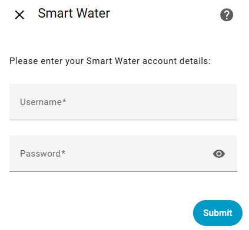
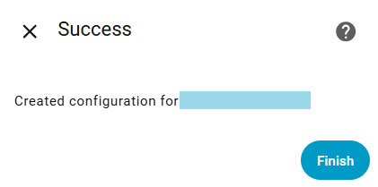
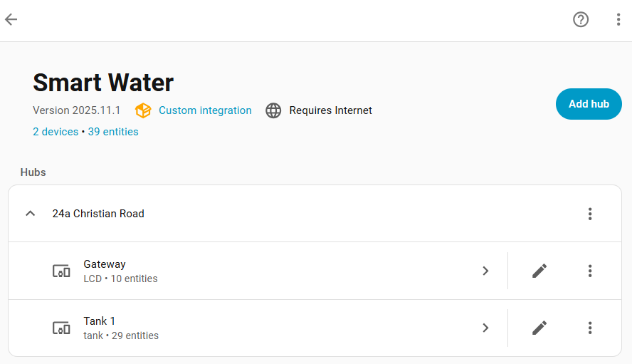
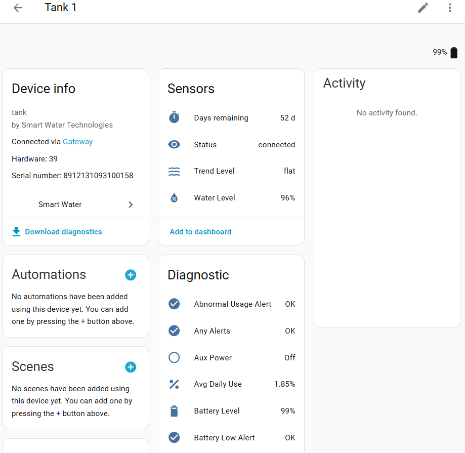
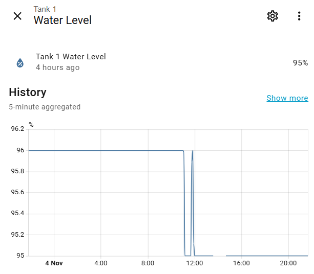

[](https://github.com/ankohanse/hass-smart-water)
[](https://github.com/ankohanse/hass-smart-water)
[](https://github.com/ankohanse/hass-smart-water/blob/main/LICENSE)
[](https://www.buymeacoffee.com/ankohanse)


# Smart Water

[Home Assistant](https://home-assistant.io/) custom component for retrieving sensor information from Smart Water branded devices.
This component connects to the remote Smart Water Technology servers and automatically determines which gateways, tanks and pumps are available there.

The custom component is compatible with SW900 devices (Desk Mount Wifi LCD, Wall Mount WiFi LCD, Tank Level Sender and Wireless Pump Controllers).

Legacy SW800 devices are not supported as these do not have WiFi/internet connectivity.


# Prerequisites
This library depends on the backend servers for the Smart Water app to retrieve the device information from. 

Before using this library, the Smart Water app must have been used to link the desktop or wall-mount WiFi LCD to the Smart Water services.


# Installation

This custom integration is available via Home Assistant Marketplace.
1. Go to Settings → Marketplace and search for 'smartwater'.
2. Click on the found item to display this readme (this page).
3. At the top of the page press 'Install'
5. Follow the displayed setup steps

## Step 1 - Connection details
The following properties are required to connect to the Smart Water servers:
- Username: email address as registered with Smart Water
- Password: password associated with the username
  


## Step 2 - Finish
The integration will try to connect to the Smart Water servers to retrieven the user's profile.
If this succeeds, it will create entities for the found gateways, tanks and pumps.



## Devices
After succcessful setup, all devices from the Smart Water profile should show up in a list.



On the individual device pages, the hardware related device information is displayed, together with sensors typically grouped into main entity sensors, controls and diagnostics.

Any sensors that you do not need can be manually disabled using the Home Assistant integration pages.




## Sensors
Sensors are registered to each device as `sensor.{device_id}_{sensor_name}` with an easy to read friendly name of `sensor_name`. 
  



# Troubleshooting
Please set your logging for the this custom component to debug during initial setup phase. If everything works well, you are safe to remove the debug logging:

```yaml
logger:
  default: warn
  logs:
    custom_components.smartwater: debug
```

